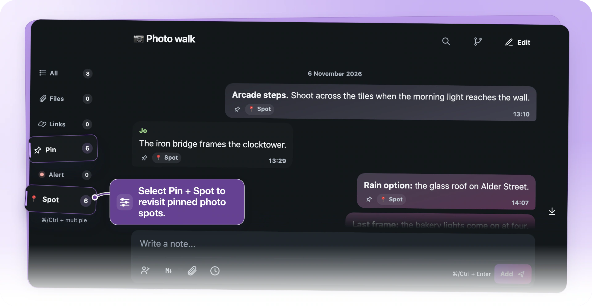
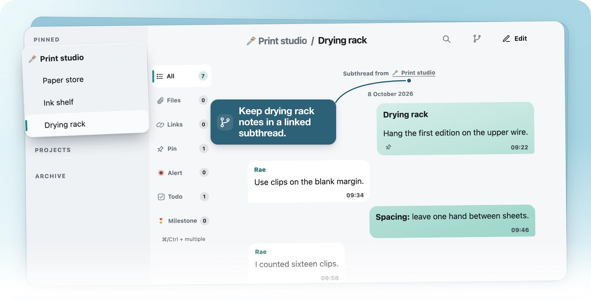
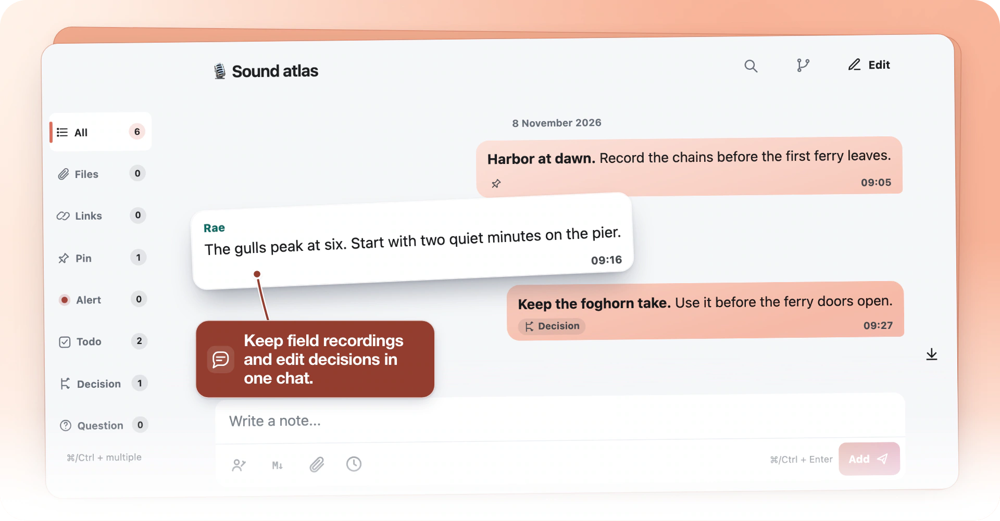
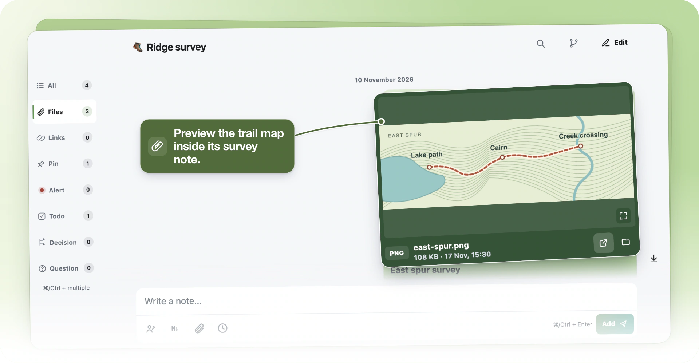
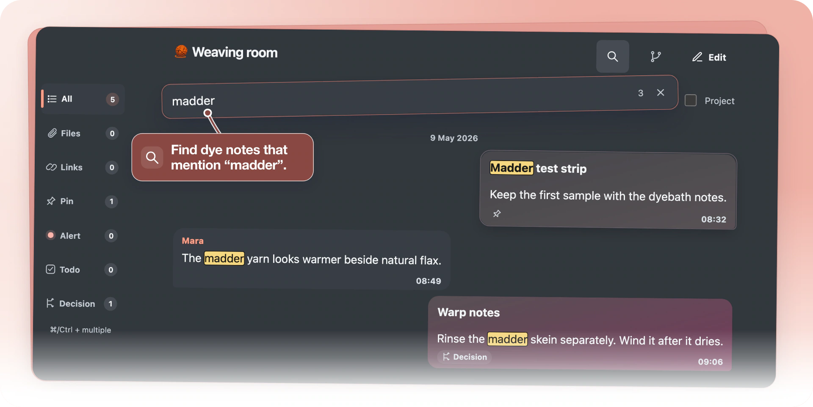

<h1 align="center">
  <picture>
    <source media="(prefers-color-scheme: dark)" srcset="branding/threadstr/v1/wordmark/threadstr-wordmark-on-dark.svg">
    
  </picture>
</h1>

<p align="center"><strong>A personal project notebook that reads like a chat.</strong></p>

<p align="center">
  Works offline on macOS, Windows, and Linux · <a href="LICENSE">Apache 2.0</a>
</p>

<p align="center">
  <a href="docs/install/README.md"><strong>Install threadstr</strong></a> ·
  <a href="docs/USER_GUIDE.md">User guide</a> ·
  <a href="CHANGELOG.md">Changelog</a> ·
  <a href="CONTRIBUTING.md">Contributing</a> ·
  <a href="https://t.me/threadstr_app"><strong>Telegram community</strong></a>
</p>











## What you can do

- **Keep a notebook for each project.** Capture progress, decisions, and context
  in a chronological thread. Pin active projects and archive finished ones.
- **Write rich notes.** Use Markdown, checklists, tables, links, and dated plans.
- **Find what matters.** Mark important notes and filter by labels, files, or links.
- **Keep files in context.** See attached JPEG and PNG pictures as you read a
  thread. Select a picture for a larger view, or use Open to edit a supported
  file in its usual application.
- **Take your work with you.** Export all or selected projects with their files,
  then restore them or import independent copies.
- **Attribute a note to someone.** Use the Sender field to record who made a
  suggestion or decision, such as a teammate or a friend.

## Ultra Quick start

Give your AI agent this request.

```
Install this tool https://github.com/satankov/on-track
```

## Quick start

This checkout prepares **v0.2.1**. The installers below select the latest
published release. See the [changelog](CHANGELOG.md) for changes and upgrade guidance.

On **macOS or Linux**, run this command in Terminal.

```sh
curl -fsSL \
  https://github.com/satankov/on-track/releases/latest/download/install.sh \
  -o thr-install.sh && bash thr-install.sh --no-open
```

Setup downloads the required runtime, builds the app, and starts it in the
background. Open the address it prints in your browser. You can then close the
terminal. The installer supplies Node.js and works without Git.

**Windows** — follow the [PowerShell quick start](docs/install/windows.md).

Managed installation is experimental. See the detailed guides for
[macOS](docs/install/macos.md), [Linux](docs/install/linux.md), and
[Windows](docs/install/windows.md), or use [manual setup](docs/USER_GUIDE.md#manual-setup).

## Run, stop, and update

After managed setup, use these commands in a new terminal.

| Command         | What it does                                               |
| --------------- | ---------------------------------------------------------- |
| `thr run`       | Start threadstr and open your browser                      |
| `thr stop`      | Stop the local server and keep your projects saved         |
| `thr status`    | Show the server status and local address                   |
| `thr logs`      | Show recent diagnostics                                    |
| `thr uninstall` | Remove the app and its dependencies while keeping projects |
| `thr update`    | Install the latest stable release and restart              |

To remove projects and attachments as well, use `thr uninstall --delete-data`
and review the paths before confirming.

The server keeps running when you close the browser. After a reboot, run
`thr run` again. Before updating, preserve drafts and export a backup. Refresh
your browser tabs when the update finishes. Use `thr --help` for options.

The `ontrack` alias remains supported. See [updates and existing installations](docs/install/README.md#transition-from-on-track)
for custom paths, version-specific updates, and compatibility details.

## Home updates and help

Home includes **Check releases**, which contacts GitHub only when clicked. It
shows recent stable releases and copyable instructions for the running managed
or manual installation. Run the commands in your terminal to update. Results
are cached in memory for five minutes. GitHub receives ordinary connection
metadata. Your project content stays on your computer.

The help area links to the guides and source repository. **Report a bug — coming
soon** marks a planned feature. To report a bug today, use the
[issue tracker](https://github.com/satankov/on-track/issues).

## Platforms and your data

Run threadstr on **macOS, Windows, and Linux**. After a one-time local setup,
open the workspace in your existing web browser.

**Your data lives on your computer, and you own it.** Notes and attachments stay
in a local application-data folder, separate from the app itself. There are no
accounts, analytics, or cloud sync, and threadstr does not upload your project
data. Normal use works offline. Installation and explicit updates download
software.

The database, attachments, and backup files are unencrypted. Use
**Settings → Backups** to export your projects and files. See the
[user guide](docs/USER_GUIDE.md#where-your-data-lives) for storage locations,
backup options, and limits.

## Guides and community

[Telegram community](https://t.me/threadstr_app) ·
[User guide](docs/USER_GUIDE.md) · [Installation](docs/install/README.md) ·
[Contributing](CONTRIBUTING.md) · [Security](SECURITY.md) ·
[Changelog](CHANGELOG.md) · [Report an issue](https://github.com/satankov/on-track/issues)

## Project direction

See the [product vision and roadmap](docs/PROJECT.md) for what is next, and
[architecture and data boundaries](docs/ARCHITECTURE.md) for how it works.
Encryption and device sync are future work.

## License

[Apache License 2.0](LICENSE) — free to use, modify, and distribute for personal
or commercial purposes under its terms.
